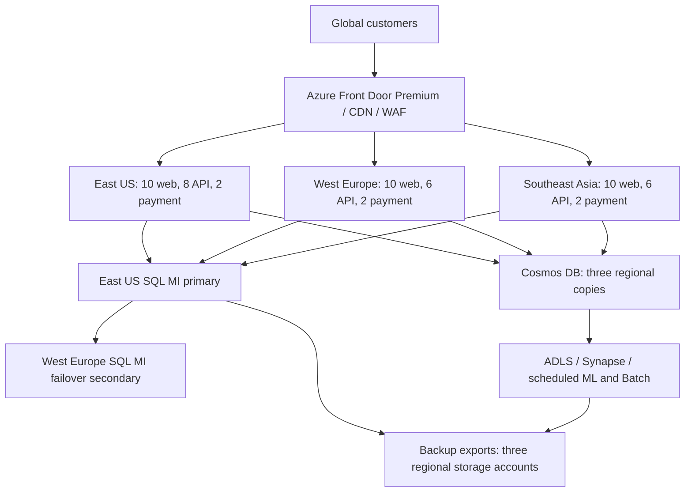

# 1. Cost estimate report

## Executive decision

Budget **$101,330.52 for migration**, including labour, a destination dual-run month and 15% contingency. After go-live, the modeled PAYG cost is **$59,842.86/month**, split into **$55,206.86 operations** and **$4,636.00 management**. Once utilization is validated, one-year reservations for the steady application and SQL baseline reduce that to **$55,096.93/month**. No Hybrid Benefit is assumed in the recommended budget.

The estimate uses Azure because its VM scale sets, managed SQL, Cosmos DB, analytics and license benefits cover the scenario. This is a budgeting architecture; traffic traces, database IOPS, licensing inventory and recovery tests remain necessary to validate its sizing.

## Scope and explicit assumptions

| Input | Assumption used |
| --- | --- |
| Regions | East US, West Europe and Southeast Asia |
| Time and currency | 730 hours/month, 12 months/year, USD; no taxes, inflation or currency conversion |
| Web front end | 10 Linux D4s v5 VMs per region, 30 total, 4 vCPU/16 GiB each |
| API services | All 50 services across 20 baseline Linux D4s v5 VMs globally: 8/6/6 by region; another 8/6/6 during peaks |
| Peak duty cycle | Additional API capacity runs 146 hours/month (20%); base 20 VMs stay online |
| Payment | Two Windows D4s v5 VMs per region, six total; isolated subnets and zone distribution |
| Primary SQL | SQL Server source assumed; 16-vCore Gen5 General Purpose SQL Managed Instance in East US and full-size failover instance in West Europe; zone redundancy priced for both |
| SQL storage | 5,120 GB provisioned on each instance, a conservative budgeting translation of the 5 TB requirement; validate database files, growth headroom and actual billing units |
| NoSQL | Cosmos DB for NoSQL; 10,000 GB logical data replicated to all three regions; single-write-region account, 20,000 RU/s per region |
| Warehouse | 15,000 GB ADLS with Synapse serverless SQL; 200 TB queried/month; this is a lake-backed reporting warehouse, not a dedicated SQL pool |
| ML and batch | Two NC4as T4 v3 VMs in East US for 160 hours each/month; ten D4s v5 batch workers for 60 hours each |
| Delivery | 100,000 GB/month Front Door client delivery; 100 million requests; 20,000 GB origin traffic; 2,000 GB separate direct egress |
| Backup | 40,000 GB effective retained backup/export data per region, 120,000 GB billed across three copies; 30-day operational retention assumed |
| Cross-region changes | 5,000 GB source changes/month copied to two destinations, 10,000 GB transfer billed in total |
| Logs | 600 GB application/platform logs + separate 150 GB security logs monthly; 1,000 GB long-term archive |
| Migration | 30 days; 30 TB logical data (5 + 10 + 15); 10% change during migration; 200 total project labour hours |

The model interprets 20 API VMs as a global number. If it means 20 **per region**, additional compute, disks, monitoring and peak capacity must be added. Millions of users alone cannot determine bandwidth or transaction throughput; the explicit traffic assumptions drive this estimate.

## Architecture and reliability

Deploy web, API and payment instances across available zones, with health probes and regional load balancing. Front Door routes to healthy regions and caches static content. The 50 microservices remain on VM Scale Sets initially; Kubernetes fees are not included because AKS is not part of this baseline. VM count is not microservice count.

An SQL failover group links **two** managed instances; Southeast Asia reaches the current writer. This creates cross-continent write latency, so benchmark checkout before accepting this topology. A region-local order-processing or sharded design would be a separately costed redesign. Regional VM quotas must allow survivor regions to scale during failure; normal burst capacity is not a guarantee of N-1 regional capacity. An additional month of full API burst runtime costs about $2,543.90 above the modeled duty cycle. [SQL failover groups](https://learn.microsoft.com/en-us/azure/azure-sql/managed-instance/failover-group-sql-mi)

GRS/GZRS uses a paired region; it does not automatically satisfy three arbitrary-region copies. This estimate funds three separately billed storage accounts, with scheduled consistent backup exports/copies and explicit transfer charges. Azure Backup vault storage cannot simply be assumed to support arbitrary object replication. Native SQL backup above included entitlement is priced separately; the three-region export tier intentionally adds another recovery path. Copies are asynchronous. [Azure storage redundancy](https://learn.microsoft.com/en-us/azure/storage/common/storage-redundancy)

Proposed targets: application recovery within 1 hour, SQL regional RPO under 5 minutes/RTO under 1 hour, and analytics/backup RPO 24 hours/RTO 24 hours. These are design targets, not measured or guaranteed SLAs. Validate forced failover data loss, replay/idempotency, immutable retention and quarterly restoration tests. One region's disaster must not authorize destructive writes in another.

## Payment security

Use TLS 1.2 or later end-to-end, managed identities, Key Vault, encryption at rest, restricted ingress, least-privilege roles, patching and security logs. Tokenize payments and avoid persisting sensitive authentication data. The firewall, WAF and Defender provisions contribute to the control set. Azure's PCI assessment does **not** certify ShopPro's implementation; ShopPro retains responsibility for application controls and assessment scope. External assessor fees and processor transaction fees are excluded because no scope or transaction volumes were supplied. [Microsoft PCI DSS guidance](https://learn.microsoft.com/en-us/azure/compliance/offerings/offering-pci-dss)

## Cost calculation and evidence

Every charge is quantity × rate. PAYG compute uses instance-hours; databases add compute, licensing, regional copies and storage separately. Read the [complete monthly breakdown](cost-breakdown.md) for all quantities, rates and evidence classifications. The [migration breakdown](migration-breakdown.md) separates cloud resources, replication, staging, labour and contingency.

The calculator was configured for 20 East US Linux D4s v5 VMs × 730 hours and returned **$2,803.20/month**, matching 20 × 730 × $0.192. This is a compute-only cross-check: the export uses Linux for all 20 equivalent slots; the full model separately adds the Windows license difference for two payment VMs. It is not a quote for the full East US deployment. See the [export](evidence/calculator-eastus-compute.xlsx).

Verified unit rates use [Azure's Retail Prices API](https://learn.microsoft.com/en-us/rest/api/cost-management/retail-prices/azure-retail-prices), retrieved November 5, 2026. SQL license rate, networking tiers, support, backup and management rates are explicit planning allowances. A full calculator export/contract quote for those lines remains necessary before procurement or a submission requiring a complete vendor-calculator export. Discounts are not applied to storage, bandwidth or licensing by inference.

Migration service fees are provisionally zero; this is not a claim that migration is free. Microsoft documents free DMS options, but supported tooling must be checked for the selected source and target. The estimate includes temporary replication workers, staging, delta transfer and a full target overlap month. [DMS pricing](https://azure.microsoft.com/en-gb/pricing/details/database-migration/)

## Accounting boundaries and uncertainty

Destination overlap is included once in migration, before the three operating years. Initial copy and delta traffic are migration expenses; ongoing changed-data transfer is operating expense. Front Door delivery is not also counted as generic Internet egress. Security ingestion uses a combined allowance for a separate 150 GB stream, avoiding double billing that stream in Log Analytics. Burst disks are retained and billed even when compute stops.

No SLA credits, free trials, negotiated enterprise discounts, tax, Software Assurance purchase costs, Power BI seats, developer workstations, source datacenter costs or permanent operations staff salaries are included. The migration labour estimate is separate from ongoing platform management services. At least 15% contingency is recommended, but it cannot substitute for validating traffic: a further 100 TB/month at the blended delivery allowance adds **$10,000/month**. Similarly, each extra 10 TB of retained backups across three regions adds **$600/month** at the assumed storage rate, before transactions and replication.
