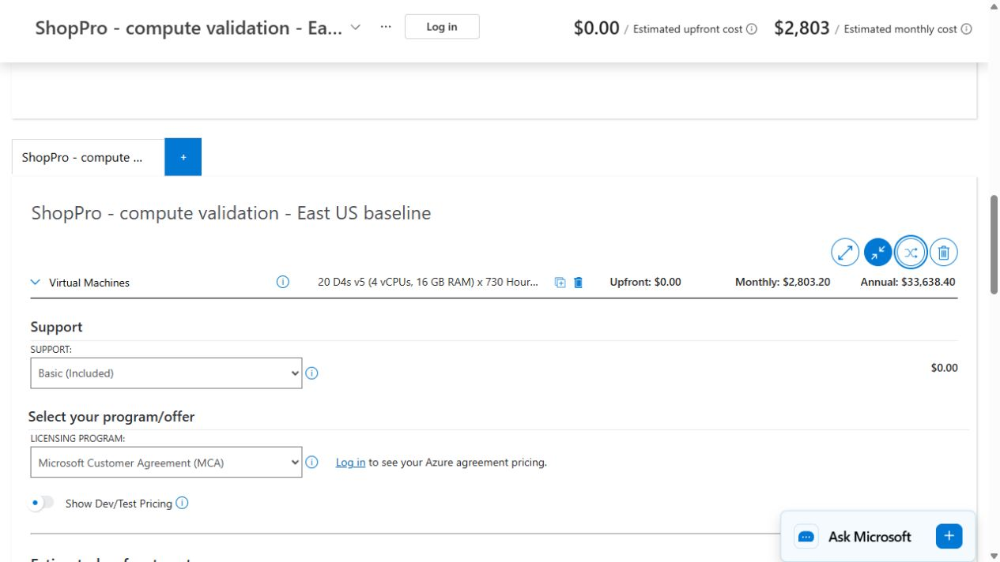

# Calculator configuration and reconciliation

## Captured evidence

On November 5, 2026, the [Azure Pricing Calculator](https://azure.microsoft.com/en-us/pricing/calculator/) was configured with:

- Service: Virtual Machines; region: East US; operating system: Linux / Ubuntu.
- Instance: D4s v5, four vCPUs and 16 GB RAM.
- Quantity: 20; runtime: 730 hours; PAYG; USD; basic support.
- No managed disks in this compute-only validation. The export retains the calculator's default 5 GB East US-to-East Asia transfer setting, which showed $0 for bandwidth; actual network usage is modeled separately.
- Result: **$2,803.20/month**, **$33,638.40/year**, **$0 upfront**.

The 20 slots equal ten web, eight baseline API and two payment compute equivalents. The calculator cross-check uses Linux for all slots. The full estimate adds Windows licensing to the two payment VMs, plus bursts, disks and other services. The export is a validation sample and must not be presented as a complete cloud quote.

## Complete estimate entry guide

Use `cost-breakdown.md` as the bill of materials. Create distinct regional entries; do not assume East US prices globally.

| Calculator service | Configuration to reproduce |
| --- | --- |
| Virtual Machines | Web 10 Linux D4s v5 per region × 730h; API 8/6/6 ×730h plus 8/6/6 ×146h; payment 2 Windows D4s v5 per region ×730h |
| Managed disks | 76 retained OS disks; choose a suitable Premium SSD size and replace the $20/disk allowance |
| SQL Managed Instance | Two GP Gen5 16-vCore instances, East US and West Europe; zone redundancy; 5,120 GB each; license included |
| Cosmos DB | 10,000 GB per regional copy, three regions, single write region, 20,000 RU/s provisioned per region; confirm actual billed storage incl. indexes |
| Front Door Premium | One profile; 100 TB client delivery allocated by customer geography (assume 40% NA, 35% Europe, 25% APAC until measured); 100m requests; 20 TB origin traffic |
| Load Balancer | Three regional load balancers, 730h each, 20 TB aggregate processed data; validate rule count |
| Networking/security | Three regional firewalls, private endpoints/DNS/peering; 10 TB cross-region changes; 2 TB direct Internet egress |
| Storage / Synapse | 15 TB ZRS ADLS warehouse; serverless SQL 200 TB scanned/month; no dedicated SQL pool |
| ML and batch | East US two NC4as T4 v3 ×160h, ten D4s v5 ×60h; add pipeline orchestration |
| Backup | 40 TB retained exports in each of three regional storage accounts; 56 protected baseline VMs; 10 TB incremental native SQL backup storage |
| Monitor / Sentinel / Defender | 600 GB application logs; separate 150 GB security ingestion with combined rate checked; 1 TB archive; 60 effective VM-months Defender; other allowances as itemized |
| Support | Replace the $1,000/month allowance with the approved support plan |

Duplicate the estimate for one-year and three-year reservations. Apply VM and SQL reservations only to eligible steady compute. Leave burst and scheduled resources PAYG. Make a separate conditional Hybrid Benefit copy after verifying licenses. Export each complete estimate and reconcile each difference to region, SKU, tier, usage, discount, billing units or allowance replacement. Save the exports and capture date in `evidence/`.

For migration, use a separate 30-day estimate with four temporary Linux VMs, staging storage, VPN, initial and delta copy traffic, and one destination PAYG month. Engineering labour belongs in the supplemental model, not in a fabricated Azure service line.
